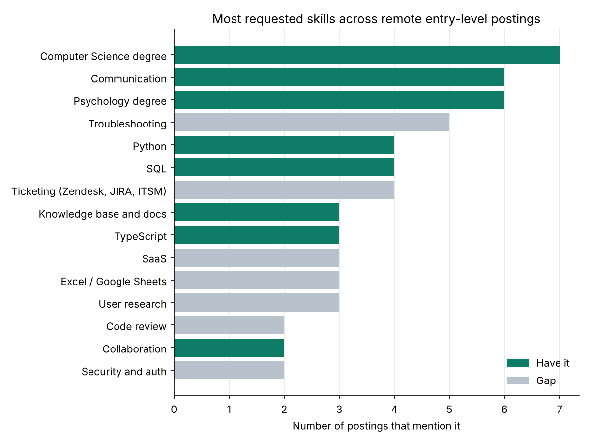

# Job Market Analyzer

A Python tool that reads a CSV of job postings, pulls out the skills each one
asks for, and shows which skills are in demand, how well a candidate's skills
match each posting, and what pay looks like by job type.



## What it does

- **Skill extraction**: matches 36 skills across 7 categories using regular
  expressions with custom word boundaries, so `Java` doesn't match inside
  `JavaScript`, `C++` and `Node.js` match despite their symbols, and the language
  `R` doesn't match inside words like `R&D`. Synonyms roll up to one skill
  (Jenkins counts as CI/CD; Zendesk, JIRA and ServiceNow count as ticketing).
- **Experience parsing**: reads "1-3 years", "5+ years" and similar phrases and
  records the lowest bar to entry.
- **Candidate matching**: scores every posting by the share of its skills a
  profile has, lists what's missing, and breaks ties by lower experience bars.
- **Gap analysis**: ranks the skills a profile lacks by how many postings want them.
- **Pay normalisation**: turns posted ranges into a yearly midpoint (hourly
  rates x 2,080 hours) and reports the median by track and currency.
- **Output**: a Markdown report, two charts (top skills, skills-by-track heatmap)
  and CSVs for further analysis.

## Dataset

`data/postings.csv` holds 26 real remote job postings collected in November 2026
from public job boards (Remotive, Built In, Working Nomads, and others; the
`source` column names each one). It covers six tracks: software development,
technical support, data analysis, AI training, trust & safety, and UX research.
Only details stated in each posting are recorded; blank pay means none was posted.

You can point the tool at any CSV with `title`, `company`, `track` and
`requirements` columns (pay columns are optional).

## Run it

```bash
python -m venv .venv
source .venv/bin/activate        # Windows: .venv\Scripts\activate
pip install -r requirements.txt
python analyze.py --data data/postings.csv --profile profile.json --out reports
```

Edit `profile.json` to try a different set of skills.

## Findings from the included data

- A **Computer Science degree** was the most-named requirement (7 of 26 postings),
  followed by **communication** and a **psychology degree** (6 each).
- **Troubleshooting** and **ticketing tools** (Zendesk, JIRA, ServiceNow) were the
  biggest gaps for the sample profile, driven by support and trust & safety roles.
- Software roles leaned on **TypeScript** and **React** (2 of 3 postings each);
  data roles on **SQL** (3 of 5).

See [reports/report.md](reports/report.md) for the full tables.

## Tests

```bash
pytest --cov=analyzer --cov=analyze
ruff check .
```

19 tests cover the tricky extraction cases, years parsing, pay conversion,
matching, and an end-to-end run of the command line tool (98% coverage).

## Limitations

- Keyword matching can't tell "required" from "nice to have".
- Pay is not converted between currencies, and hourly contract rates are shown
  as full-time equivalents.
- 26 postings is a small sample; treat the numbers as directional.
