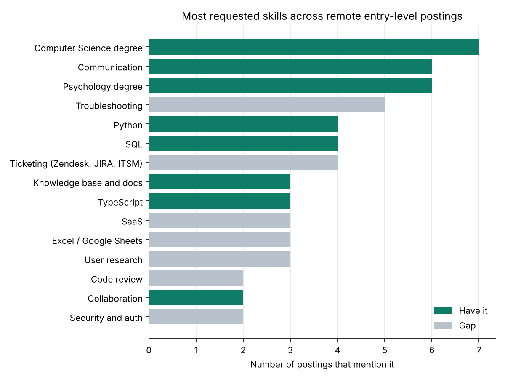
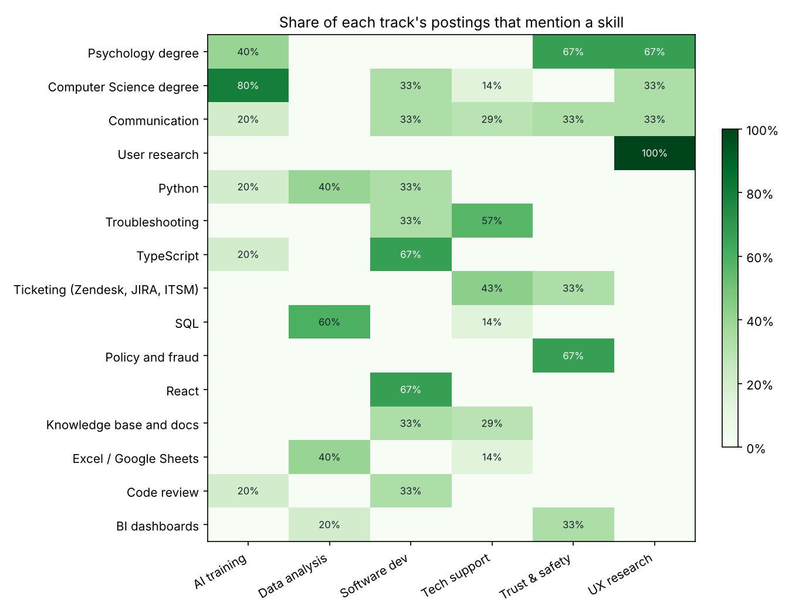

# Remote Job Market Report

26 postings across 6 tracks. Profile: **Ishkaran Brar**.

## Best-matching postings

Match = share of the skills a posting names that this profile has. "Years asked" is the lowest
experience figure the posting states; check it before applying.

| title | company | track | match | years asked | missing |
| --- | --- | --- | --- | --- | --- |
| Technical Support Specialist | Greenhouse | support | 100% | not stated | none |
| Junior Data Analyst | Trading Academy | data | 100% | not stated | none |
| Coding Expertise for AI Training | Outlier | ai_training | 100% | not stated | none |
| Psychology Graduates - AI Training | Prolific | ai_training | 100% | not stated | none |
| Trust & Safety Specialist | Virtual Vocations listing | trust_safety | 100% | 1+ | none |
| Cognitive Scientist AI Trainer | remowork listing | ai_training | 100% | 2+ | none |
| Computer Science Expert | Mercor | ai_training | 100% | 3+ | none |
| Mixed-Methods UX Researcher | Huckleberry | ux_research | 75% | not stated | User research |
| Junior Software Developer, Backend | Hootsuite | software | 56% | 1+ | Agile, Code review, Security and auth, Troubleshooting |
| Junior Software Developer | Raymont Residential College | software | 50% | not stated | Django, React |

## Biggest skill gaps

Skills this profile doesn't list yet, ranked by how many postings ask for them.

| skill | category | postings | share |
| --- | --- | --- | --- |
| Troubleshooting | Support and operations tools | 5 | 19% |
| Ticketing (Zendesk, JIRA, ITSM) | Support and operations tools | 4 | 15% |
| SaaS | Frameworks and platforms | 3 | 12% |
| Excel / Google Sheets | Data and analytics | 3 | 12% |
| User research | Human and domain skills | 3 | 12% |
| Code review | Engineering practices | 2 | 8% |
| Security and auth | Engineering practices | 2 | 8% |
| React | Frameworks and platforms | 2 | 8% |
| ETL and data validation | Data and analytics | 2 | 8% |
| BI dashboards | Data and analytics | 2 | 8% |

## Pay by track

Yearly midpoint of posted ranges; hourly rates x 2,080 hours. Currencies are not converted.
Most AI-training work is part-time contract work, so those yearly figures show the full-time
equivalent, not typical earnings.

| track | currency | postings | median_annual |
| --- | --- | --- | --- |
| AI training | CAD | 1 | 89,440 |
| Software dev | CAD | 1 | 81,200 |
| Tech support | CAD | 2 | 57,603 |
| AI training | GBP | 1 | 104,000 |
| Trust & safety | GBP | 1 | 50,000 |
| AI training | USD | 2 | 144,560 |
| UX research | USD | 2 | 104,000 |
| Trust & safety | USD | 1 | 53,500 |
| Data analysis | USD | 2 | 46,250 |

